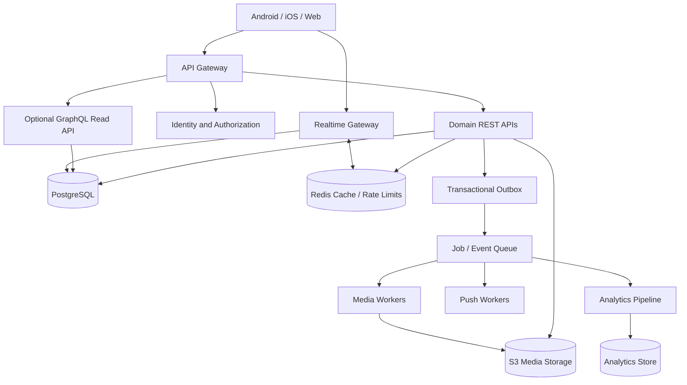
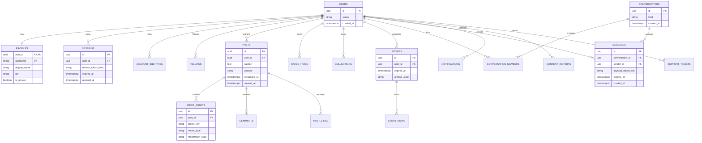

# Opexnal Production System Architecture

**Status:** Target architecture and implementation contract — not a claim that every capability is already implemented or deployed.

## 1. Architecture principles

1. Opexnal uses its own branding, UI assets, wording and implementation. This document describes familiar social-product capabilities; it does not authorize copying Instagram source code, logos, proprietary assets or protected screen designs.
2. PostgreSQL is the source of truth for accounts, permissions, content metadata, relationships, messages and settings.
3. Redis is an ephemeral hot layer for cache, rate limits, short-lived session/presence data and queue coordination. It is never the only copy of user content or messages.
4. S3-compatible object storage holds media objects. PostgreSQL stores object keys, checksums, ownership, moderation state and lifecycle metadata.
5. Add Cassandra or another wide-column archive only after measured throughput/retention requirements justify the operational cost. Do not duplicate private or deleted content into an undeclared archive.
6. REST is the initial command/write API. GraphQL may be introduced for complex read aggregation after authorization, query-cost limits and schema governance are in place.
7. WebSocket events are delivered through an authenticated gateway and durable event/outbox pipeline. Push delivery is best-effort; the in-app inbox remains authoritative.
8. All capabilities require server-side authorization, validation, observability, tests, documented retention and failure handling.

## 2. Logical architecture



### Responsibilities

| Layer | Responsibility | Durability |
|---|---|---|
| PostgreSQL | Users, profiles, settings, follows, posts, comments, messages, reports, permissions | Durable source of truth |
| Redis | Cache, rate-limit counters, transient presence, queue coordination | Rebuildable / ephemeral |
| Object storage | Original and transformed photos, videos, audio, thumbnails | Durable with lifecycle policy |
| Queue + outbox | Reliable asynchronous work and event publication | Durable queue/outbox |
| Analytics store | Aggregated and appropriately minimized metrics | Retention governed |
| WebSocket | Live delivery and presence updates | Not the source of truth |

## 3. Data model / ERD



### Required additional tables

- Identity/security: `account_identities`, `sessions`, `two_factor_methods`, `login_events`, `trusted_devices`, `account_links`.
- Social: `follows`, `follow_requests`, `blocks`, `restrictions`, `mutes`, `favorites`, `post_tags`, `post_locations`.
- Content: `posts`, `media_assets`, `post_likes`, `comments`, `comment_likes`, `saved_items`, `collections`, `scheduled_posts`.
- Stories: `stories`, `story_views`, `story_reactions`, `story_stickers`, `close_friends`, `story_hidden_users`, `story_highlights`, `highlight_items`.
- Messaging: `conversations`, `conversation_members`, `messages`, `message_receipts`, `message_reactions`, `message_attachments`, `message_requests`, `call_sessions`.
- Safety/support: `content_reports`, `moderation_cases`, `appeals`, `copyright_cases`, `support_tickets`, `audit_events`.
- Notifications/analytics: `notifications`, `notification_preferences`, `event_outbox`, `analytics_daily`.

All user-owned tables need ownership constraints, indexes, retention rules and authorization tests. Use soft deletion only where required for a documented recovery window; hard deletion and backup expiry must be part of the deletion workflow.

## 4. API contract inventory

Base path: `/api/v1`. Use JSON, UUID identifiers, cursor pagination, idempotency keys for retryable writes, consistent error envelopes and OpenAPI documentation. Never trust a user ID supplied by the client when it can be derived from the authenticated principal.

### Authentication and accounts

| Method | Path | Purpose |
|---|---|---|
| POST | `/auth/register` | Register email/phone identity |
| POST | `/auth/login` | Authenticate |
| POST | `/auth/otp/send` | Request verified OTP |
| POST | `/auth/otp/verify` | Verify OTP |
| POST | `/auth/oauth/{provider}/callback` | Validate provider login |
| POST | `/auth/refresh` | Rotate refresh token |
| POST | `/auth/logout` | Revoke current session |
| POST | `/auth/password/reset` | Start password recovery |
| POST | `/auth/2fa/setup` | Enroll second factor |
| POST | `/auth/2fa/verify` | Verify second factor |
| GET | `/account/sessions` | List active sessions |
| DELETE | `/account/sessions/{sessionId}` | Revoke session |
| GET | `/account/linked` | List linked accounts |
| POST | `/account/linked` | Link another account |
| DELETE | `/account/linked/{accountId}` | Unlink account |
| PATCH | `/account/privacy` | Update account visibility |

Enforce the product's account-switching limit on the server. OAuth provider setup, phone/SMS delivery and Apple/Google/Facebook developer credentials are external prerequisites.

### Feed, profiles and posts

| Method | Path | Purpose |
|---|---|---|
| GET | `/feed/following` | Following feed |
| GET | `/feed/favorites` | Favorites feed |
| GET | `/feed/explore` | Discovery feed |
| GET | `/users/{username}` | Public profile |
| GET | `/users/{id}/posts` | Profile posts |
| POST | `/posts` | Create post / carousel |
| GET | `/posts/{postId}` | Read post |
| PATCH | `/posts/{postId}` | Edit post |
| DELETE | `/posts/{postId}` | Delete post |
| PUT | `/posts/{postId}/like` | Like |
| DELETE | `/posts/{postId}/like` | Unlike |
| POST | `/posts/{postId}/comments` | Add comment |
| GET | `/posts/{postId}/comments` | List comments |
| PUT | `/posts/{postId}/save` | Save to collection |
| DELETE | `/posts/{postId}/save` | Unsave |
| POST | `/posts/{postId}/share-link` | Create share link |
| POST | `/posts/{postId}/tags` | Tag users |
| POST | `/posts/{postId}/schedule` | Schedule publication |
| POST | `/media/upload-intents` | Create signed upload |
| POST | `/media/{assetId}/complete` | Finalize and validate upload |

### Reels, audio and stories

| Method | Path | Purpose |
|---|---|---|
| GET | `/reels/feed` | Reels feed |
| POST | `/reels` | Publish reel |
| POST | `/reels/{id}/views` | Record qualified view |
| POST | `/reels/{id}/remix` | Create permitted remix |
| GET | `/audio-library` | Licensed audio catalog |
| PUT | `/audio-library/{id}/save` | Save audio |
| POST | `/stories` | Publish story |
| GET | `/stories/feed` | Story tray |
| POST | `/stories/{id}/views` | Record story view |
| POST | `/stories/{id}/reactions` | React to story |
| POST | `/stories/{id}/sticker-responses` | Poll, quiz, question response |
| GET | `/stories/archive` | Owner's eligible archive |
| POST | `/highlights` | Create highlight |
| POST | `/highlights/{id}/items` | Add archived story |
| PATCH | `/story-privacy` | Reply/share/hide preferences |
| PUT | `/close-friends/{userId}` | Add close-friend member |
| DELETE | `/close-friends/{userId}` | Remove close-friend member |

Story expiry and archive transitions must run server-side. Audio, music, remix and effects integrations require licensing and provider review.

### Messaging and calls

| Method | Path | Purpose |
|---|---|---|
| GET | `/conversations` | Inbox |
| POST | `/conversations` | Create conversation |
| GET | `/conversations/{id}/messages` | Cursor-paginated messages |
| POST | `/conversations/{id}/messages` | Send message |
| POST | `/messages/{id}/reactions` | React |
| POST | `/messages/{id}/forward` | Forward permitted message |
| POST | `/messages/{id}/attachments` | Attach media |
| PATCH | `/conversations/{id}/vanish-mode` | Set disappearing-message policy |
| POST | `/message-requests/{id}/accept` | Accept request |
| POST | `/calls` | Create call session |
| POST | `/calls/{id}/join-token` | Issue short-lived call token |

Use WebRTC plus TURN for calls. Message delivery/read state must be persisted; WebSocket is a delivery channel, not the message database. End-to-end encryption requires a separately reviewed cryptographic protocol and key lifecycle; do not claim E2EE merely because transport uses TLS.

### Settings, safety and support

| Method | Path | Purpose |
|---|---|---|
| GET/PATCH | `/settings` | Read/update user preferences |
| GET | `/activity` | Activity history |
| POST | `/data-exports` | Request account export |
| POST | `/account/deletion-requests` | Request deletion |
| GET/POST/DELETE | `/blocks` | Block management |
| GET/POST/DELETE | `/restrictions` | Restriction management |
| GET/PATCH | `/hidden-words` | Hidden-word filters |
| POST | `/reports` | Report content/account |
| GET | `/reports/{id}` | Report status, if authorized |
| POST | `/appeals` | Appeal moderation decision |
| POST | `/copyright/cases` | Submit rights complaint |
| GET | `/copyright/cases/{id}` | Track own case |
| POST | `/support/tickets` | Create real support ticket |
| GET | `/support/tickets` | List own support tickets |
| GET | `/notifications` | In-app notification inbox |
| PATCH | `/notifications/preferences` | Notification preferences |
| GET | `/insights/overview` | Authorized professional insights |

Support and copyright endpoints must create persisted cases and operational queues; a local toast or generated reference number is not proof of submission.

## 5. Realtime event contract

Authenticated WebSocket topics are scoped by server-side membership checks. Example events:

- `message.created`, `message.delivered`, `message.read`, `message.reaction`
- `conversation.updated`, `message_request.created`
- `presence.changed` (ephemeral and privacy-controlled)
- `notification.created`
- `call.ringing`, `call.ended`

Use event IDs, sequence numbers, replay windows, deduplication and an outbox publisher. Never broadcast a conversation event to users who are not current authorized members.

## 6. Frontend component and navigation hierarchy

```text
OpexnalApp
├── AppShell
│   ├── TopBar (brand, activity, inbox)
│   ├── MainTabs
│   │   ├── Home (StoriesTray, FeedTabs, PostCard)
│   │   ├── Explore (Search, Results, DiscoveryGrid)
│   │   ├── Create (MediaPicker, Editor, Filters, Tags, AdvancedOptions)
│   │   ├── Reels (Player, Audio, Actions, Comments)
│   │   └── Profile (Header, Highlights, Posts, Reels, Tagged)
│   └── BottomNavigation
├── Auth (Signup, Login, OTP, OAuth, Recovery, 2FA)
├── Stories (Composer, Stickers, Viewer, Archive, CloseFriends, Highlights)
├── Messaging (InboxTabs, Requests, Conversation, Composer, Voice, Reactions, Calls)
├── Settings (Account, Activity, Notifications, Privacy, Security,
│             HiddenWords, CreatorTools, BusinessTools, AccountCenter, DataControls)
└── Shared (APIClient, Auth, Realtime, UploadManager, OfflineQueue,
            ErrorBoundary, Accessibility)
```

Navigation must preserve deep links, safe back behaviour, accessibility labels, loading/empty/error states and permission-aware controls. Optimistic updates must reconcile with server responses and roll back on failure.

## 7. Security, privacy and reliability requirements

- Argon2id password hashing; short-lived access tokens; refresh-token rotation and revocation.
- OAuth state/nonce and redirect validation; MFA recovery controls.
- Per-account, per-IP and per-action rate limits; Redis-backed distributed counters.
- PostgreSQL least-privilege roles and row-level authorization tests.
- Signed, short-lived media upload/download URLs; MIME sniffing, size limits and malware scanning.
- Encryption in transit and at rest; managed secrets; key rotation.
- Audit events for sensitive account/security actions, without logging secrets or message plaintext.
- Explicit retention schedules, export/deletion workflows and backup-expiry procedures.
- Observability: structured logs, traces, metrics, SLOs, alerting and incident runbooks.
- Backups must have scheduled restore drills. Load and security tests must run before production launch.

## 8. Release gates

A feature is complete only when all applicable gates pass:

1. UI and navigation implemented on supported device sizes.
2. API contract documented and validated.
3. Database migration, indexes, constraints and rollback plan reviewed.
4. Authentication, ownership, privacy and abuse controls enforced server-side.
5. Loading, empty, offline, timeout, retry and error states implemented.
6. Unit, integration, API authorization and end-to-end tests pass.
7. Accessibility and real-device tests pass.
8. Monitoring, support ownership, retention and operational runbooks exist.
9. Required third-party credentials, licenses and provider approvals are configured.
10. Staged deployment, rollback and production smoke tests pass.

## 9. Known external prerequisites

OAuth provider applications, SMS/email delivery, push credentials, object storage, CDN, TURN/WebRTC, licensed music catalog, payment processor, app-store signing and production monitoring must be configured by authorized account owners. These cannot be truthfully marked complete from source-code changes alone.
